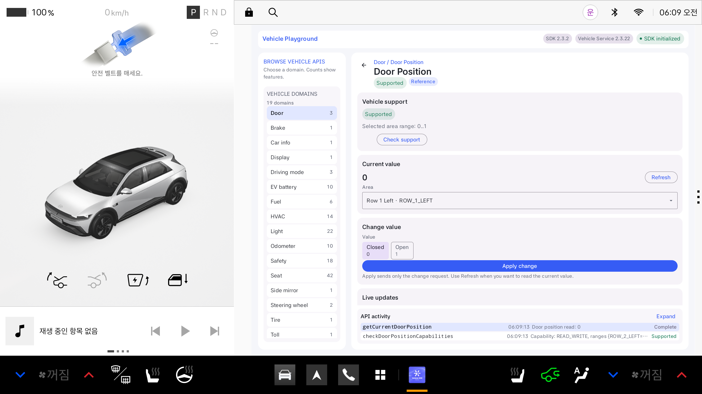

# 여행 앱 공모전 프로젝트

## 온길 기획 자료

2026-11-05에 보관한 [온길 기획·디자인 대화 정리](docs/온길_기획_디자인_대화정리_20261105.md)에서 사용자 기획서 원문, 대화 기록, Figma S-10 와이어프레임과 승인된 블루·화이트 이미지 시안을 확인할 수 있습니다. 기획 자료는 이 저장소의 `기획서` 브랜치에 반영합니다. 기존 구현의 앱명은 아직 같이가이며, 이번 기록의 온길 기획과 구분합니다.

## 개발 작업 안내

Pleos Vehicle SDK 공식 샘플을 바탕으로 차량 상태 데이터를 활용하는 여행 앱을 준비합니다.
기존 샘플의 상태 조회를 검증했고, 별도 같이가 앱에 차량·내비 연동과 로컬 일행 지도 시연을 연결했습니다.

별도 `:travel-preview` 모듈에 **같이가 미리보기**를 구성했습니다.
디자인·UI 개발은 사용자가 제공한 Pleos Connect 2.1.5 원본 두 개를 기준으로 합니다. [디자인 적용 기준](docs/design/pleos-215.md)을 먼저 확인하세요.
첫 화면에서 여행 만들기·참여하기를 살펴보고, 예시 여행을 열면 여행 홈·일정·일행·대화·추억 화면을 둘러볼 수 있습니다.
2026-10-28에 Vehicle 2.3.2와 NaviHelper 3.0.5를 연결하고, 서버 없이 움직이는 일행 지도 시뮬레이션을 추가했습니다.
실제 차량 간 위치 공유·무전·AI·앨범은 아직 연결하지 않았습니다.
여행 화면에는 MapLibre Native + OpenFreeMap 도로 지도를 넣고, 지도를 유지하면서 일정·일행·대화·추억 패널을 열도록 구성했습니다.
지도 표시는 가능하지만 앱 자체의 실제 경로 계산·회전 안내·재탐색은 아직 구현하지 않았습니다.
[차량 연동과 로컬 일행 지도 사용법](docs/같이가_차량연동과_로컬일행지도.md)을 참고하세요.
[미리보기 사용법과 공식 기준 적용 기록](docs/여행앱_미리보기.md)을 참고하세요.
이 미리보기 작업은 사용자 요청으로 `seojongwhi-ui/pleos-travel-app` 저장소의 `main`에 반영합니다.

- 원본 저장소: https://github.com/Pleos-Playground/pleos-sample-vehicle-app
- 원본 기준 커밋: `959981d960ec71144accb27af5ae5d341e72a644`
- 개발 브랜치: `main`
- [개발 환경 분석 및 상태 조회 구현 계획](docs/개발환경_분석_및_구현계획.md)
- 원본 사용 설명: [README.md](README.md)

## 현재 확인 결과

2026-10-27에 Vehicle SDK 의존성을 `2.3.1`에서 공식 배포 버전인 `2.3.2`로 수정했습니다.
Windows의 한글 프로젝트 경로에서 빌드할 수 있도록 `gradle.properties`에 `android.overridePathCheck=true`도 설정했습니다.
공식 샘플의 Kotlin 코드와 Manifest는 변경하지 않았습니다.

수정 후 확인한 결과입니다.

- `assembleDebug` 성공. 별도 `-P` 옵션 없이도 한글 경로 검사 단계를 통과했습니다.
- Pleos Connect 2.1.0 AVD에 debug APK 설치 및 샘플 앱 실행 성공.
- 앱 화면에 `SDK 2.3.2`, `Vehicle Service 2.3.22` 표시.
- Door Position의 `ROW_1_LEFT` 영역 지원 확인 성공: 읽기/쓰기 지원, 범위 `0..1`.
- `getCurrentDoorPosition`의 실제 조회 결과 `0`을 화면에서 확인.
- 검증 중 제어 요청이나 Listener 등록은 실행하지 않았습니다.

초기 빌드 실패의 원인은 샘플에 지정된 `2.3.1`이 공식 Maven에서 HTTP 404로 응답한 것이었습니다.
JDK 17, Android SDK API 34/35, Build Tools 34/35와 WHPX 가속을 사용해 위 결과를 확인했습니다.

## 다음 개발 순서

1. 문 열림 상태 하나를 읽기 전용 화면에 표시하고, 실패·미지원·값 없음 상태를 구분합니다.
2. 여행 앱에 필요한 주행 시간·거리 등으로 조회 범위를 확장합니다.

빌드 명령, 실제 API 이름과 권한, 오류 처리와 에뮬레이터 테스트 절차는 분석 문서에 정리했습니다.
테스트 APK는 `app/build/outputs/apk/debug/app-debug.apk`에 생성됩니다.
이 APK는 debug 빌드이며 공모전 제출용 release APK는 아직 만들지 않았습니다.
