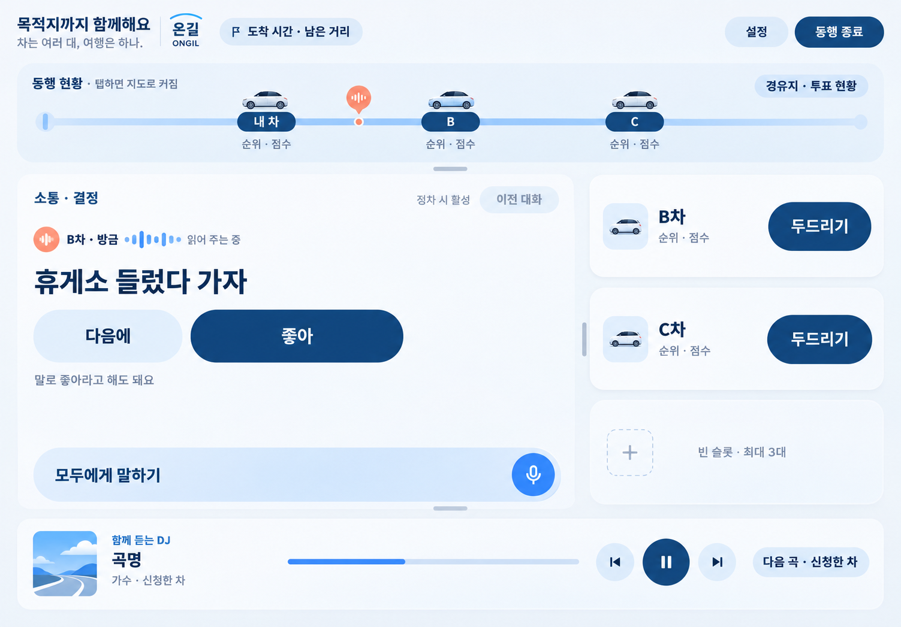

# 온길 S-10 와이어프레임과 무드 시안

보관일: 2026-11-05. 전체 기획 기록은 [대화 정리](../../../온길_기획_디자인_대화정리_20261105.md)를 참고하세요.

| 파일 | 내용 | 상태 |
|---|---|---|
| [s10-wireframe-full.png](s10-wireframe-full.png) | Figma S-10 전체 프레임과 기능 설명 | 원본 프레임의 PNG 참조 |
| [s10-wireframe-screen.png](s10-wireframe-screen.png) | 화면 부분만 분리한 이미지 | 생성 시안의 참조 |
| [s10-exploration-warm.png](s10-exploration-warm.png) | 아이보리·딥 틸 | 기획서 상세 공유 전 초기 탐색 |
| [s10-exploration-dark.png](s10-exploration-dark.png) | 차콜·민트 | 기획서 상세 공유 전 초기 탐색 |
| [s10-ongil-blue-white.png](s10-ongil-blue-white.png) | 블루·화이트와 작은 코랄 포인트 | 사용자가 승인한 무드를 적용한 첫 이미지 |

사용자는 블루·화이트 무드 설명 후 이미지 생성을 승인했습니다. 생성 결과 이미지 자체의 최종 채택이나 구현 승인을 별도로 받은 기록은 없습니다. 생성 이미지는 색감과 인상을 논의하기 위한 자료이며, 편집 가능한 Figma 컴포넌트나 실제 구현 화면이 아닙니다. Pleos 2.1.5 규격, 실제 폰트·터치 영역·대비·앱 창 배치에 대한 적합성 검증은 수행하지 않았습니다.

[이미지 생성 프롬프트](이미지_생성프롬프트.md)와 [파일 지문·크기·출처](manifest.json)를 함께 보관합니다.

## 현재 승인한 무드의 이미지

