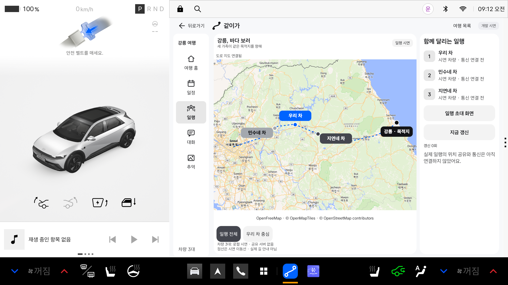

# Pleos Connect 2.1.5 디자인 적용 기준

기준일: 2026-10-30. 사용자가 지정한 아래 두 `.fig` 원본을 기준으로 현재 앱을 수정했습니다.
원본의 Kiwi 문서에서 텍스트·스타일·변수·컴포넌트 속성을 직접 추출했습니다. 일반 웹 가이드의 추정값으로 대신하지 않았습니다.

| 원본 | 역할 | SHA-256 |
|---|---|---|
| `Pleos_Connect_display_guide_215.fig` | 디스플레이·앱 영역·폼팩터 | `2283dfc1dfe871cf14fd8e15ee8831441125ef5ec471909fa17d1a03cf0bd25b` |
| `Pleos_Connect_design_assets_215.fig` | 서체·색상·아이콘 원칙·컴포넌트 | `64ddc591e4a12f765c1d3b4b36473c22c3de312c78b241aab1bf9b680a228db6` |

두 원본은 `design/reference/`에 보관하며 Git에서 제외합니다. 추출한 근거는 [pleos-215-tokens.json](pleos-215-tokens.json)에 있습니다.

## 현재 앱에 적용한 수치

Connect-S의 원본 값을 사용합니다. 아래 크기는 원본의 제작 수치이고 현재 mdpi AVD에서는 dp/sp와 같은 수치로 대응합니다.
모든 차량에 이 해상도나 크기를 강제한다는 뜻이 아닙니다. 폰트 배율과 실제 앱 창 크기는 Android 설정을 따릅니다.

| 항목 | 값 | 원본 노드 |
|---|---|---|
| 앱 수평 여백 | 20 | display guide `2003:5556`, `window/apps/padding` |
| 상단 페이지 내비게이션 높이 | 80 | assets `67:27337` |
| 주요 버튼 높이 / 모서리 | 100 / 32 | `67:21955`, `67:21956` |
| 일반 버튼 높이 / 모서리 | 80 / 24 | `67:22114`, `67:22115` |
| 작은 버튼 / 모서리 | 64 / 16 | `67:22550`, `67:22122` |
| 시스템 팝업 모서리 | 48 | `67:28787` |
| 기본 아이콘 | 48, 24 그리드 | Iconography `67:14839` |
| 아이콘 스트로크 | 3.6, round cap/join | `67:14934`, `67:14935` |
| 서체 | Asta Sans, Regular/Bold/ExtraBold | 현재 Foundation Typography, `67:7558` 등 |
| 제목 | 36/44, 32/40 | `67:7570`, `67:7573` 등 |
| 본문 | 30/38, 28/36, 26/34 | `67:7576`, `67:7579`, `67:7582` 등 |
| 라벨 | 24/28, 20/24 | `67:7585`, `67:7588` |

기존에 화면마다 지정하던 21·23·25·27 같은 문자 크기는 공통 Typography의 해당 역할로 정리했습니다.
행간도 해당 스타일과 함께 적용합니다. 새로운 화면도 `MaterialTheme.typography`를 사용합니다.

## 색상과 상태

| 원본 토큰 | Light | Dark |
|---|---|---|
| `background/primary` | `#F7F8FA` | `#1D1E21` |
| `background/secondary` | `#FFFFFF` | `#131417` |
| `surface/high` | `#EDEEF2` | `#313236` |
| `text/dark/primary` | `#131417` | `#FFFFFF` |
| `text/dark/secondary` | `#131417` 84% | `#FFFFFF` 84% |
| `button/basic/enabled` | `#131417` 5% | `#FFFFFF` 5% |
| `button/basic/pressed` | `#131417` 10% | `#FFFFFF` 10% |
| `button/filled/enabled` | `#44464E` | `#E0E1E6` |
| `button/filled/pressed` | `#313236` | `#C7C9CE` |
| `informative/positive` | `#0064FF` | `#0082FF` |

버튼·패널·본문·아이콘은 원본의 중립 색상으로 변경하고 라이트/다크를 분리했습니다.
지도 위 차량 표식과 앱 아이콘도 임의 주황색·남색 대신 제공된 색을 사용합니다. 회색 표식에는 어두운 글자로 대비를 확보합니다.
실제 지도 타일의 지형·도로·지명은 외부 지도 데이터이며, 앱 UI의 컴포넌트 토큰과 구분합니다.
지도 배경은 라이트에서 OpenFreeMap Liberty, 다크에서 OpenFreeMap Dark로 전환합니다.

## 배치와 아이콘의 적용 범위

Display guide의 Connect-S 예시는 시스템의 운전자 영역과 앱 영역을 Landscape 1:2, Portrait 1:1:1로 설명합니다 (`2124:7105`, `2124:7115`).
앱은 시스템이 할당한 Activity 크기에 반응합니다. Driving View·상태바·GNB를 앱 내부에 다시 만들지 않습니다.

현재 같이가의 지도+일행 패널 배치는 여행 서비스에 맞춘 앱 구성입니다. 이를 공식 원본의 완성 화면 복사본으로 취급하지 않습니다.
카드와 패널은 제공된 색상·모서리·타입 스케일을 조합합니다. 기존 자체 아이콘은 원본의 선 두께·그리드·round 규칙으로 정리하며 원본 에셋을 그대로 추출한 아이콘이라고 표시하지 않습니다.

현재 AVD는 Connect-S 2560×1440입니다. 실제 앱 창은 넓은 창 약 1682×1210, 좁은 창 약 841×1210입니다.
다른 폼팩터의 변수는 JSON에 함께 보관하지만 Connect-L/W/Waterfall에서 동작 검증을 완료한 것으로 주장하지 않습니다.

## 구현과 서체 출처

- `PleosDesign215.kt`: 공통 서체·타입·색상·기본 크기.
- `PreviewComponents.kt`: 일반·주요·비활성 버튼, 토글, 텍스트 버튼, 패널과 아이콘.
- `TravelPreview.kt`: 시스템 앱 영역 안의 여백·상단 내비게이션·메뉴.
- `RoadConvoyMap.kt`: 차량 이름의 Asta Sans, 표식 대비·색상.
- `res/font/asta_sans.ttf`: 원본에서 지정한 Asta Sans의 공식 Google Fonts 배포본.
- `assets/licenses/AstaSans-OFL.txt`: 서체에 동봉한 SIL Open Font License.

서체 배포 원문: [Google Fonts Asta Sans](https://github.com/google/fonts/tree/main/ofl/astasans).
원본 서체 프로젝트: [42dot/Asta-Sans](https://github.com/42dot/Asta-Sans).

기존 Vehicle/NaviHelper API, 데이터 상태 구분과 시연 로직은 디자인 적용과 별도로 유지합니다.
실제 내비게이션 엔진, 차량 간 통신이나 음성 기능을 추가하는 작업은 포함하지 않습니다.

## 이후 변경 확인

`node tools/check-pleos-design.cjs`는 원본 파일의 지문(로컬 파일이 있을 때), UI 색상과 타입 스케일을 추출 데이터와 대조합니다.
이미지 비교나 전체 가이드 적합성 인증을 대신하는 검사가 아닙니다. 배치·아이콘·실제 기기 동작은 별도로 확인합니다.

## 2026-10-30 검증 결과

- `:travel-preview:assembleDebug`, `:travel-preview:lintDebug` 성공. Lint 오류 0개, 기존 경고 10개.
- 원본 지문·색상·타입 스케일 대조 검사 통과.
- Pleos Connect 2.1.0 AVD에서 넓은 창과 좁은 창의 라이트·다크 배치 확인.
- 지도와 세 차량 이름, 패널 전환, 뒤로가기, 여행 만들기 화면 진입 확인.
- 배터리 100%의 실제 조회와 트립 정보 등의 미지원 표시 유지 확인.
- 가변 서체의 기본 굵기 300에 의존하지 않고 `wght` 400/700/800을 명시해 Regular/Bold/ExtraBold 구분 확인.
- 다크 검증 후 에뮬레이터를 원래 라이트 설정으로 되돌림.
- 원본의 시스템 팝업 모서리 48과 테마 배경을 적용한 뒤, 지도 출처 팝업 열기·닫기와 지도 복귀 확인. 최종 실행의 AndroidRuntime 오류 없음.

| 창 | Light | Dark |
|---|---|---|
| 넓은 창 | [화면](../images/pleos215-wide-light.png) | [화면](../images/pleos215-wide-dark.png) |
| 좁은 창 | [화면](../images/pleos215-narrow-light.png) | [화면](../images/pleos215-narrow-dark.png) |

변경 사항은 로컬에 적용하며 이번 디자인 요청으로 GitHub에 자동 업로드하지 않습니다.
