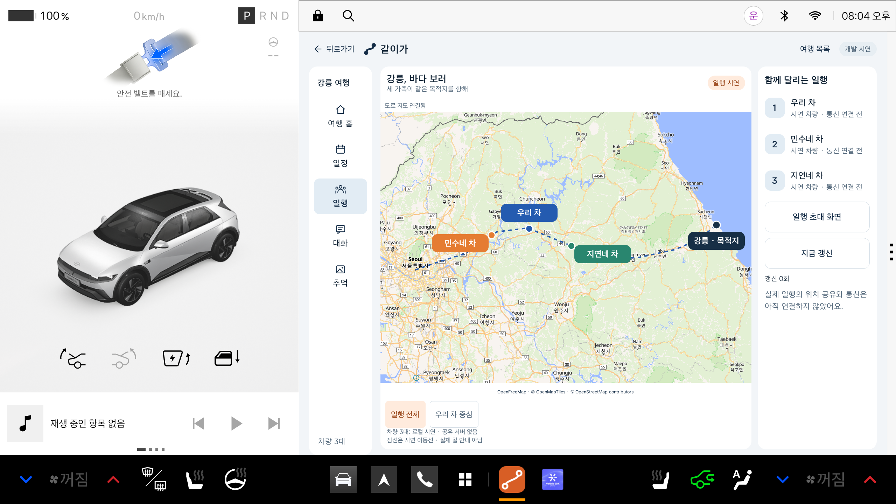
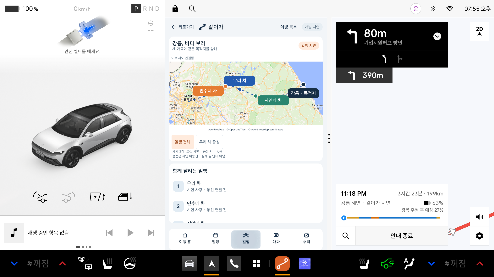
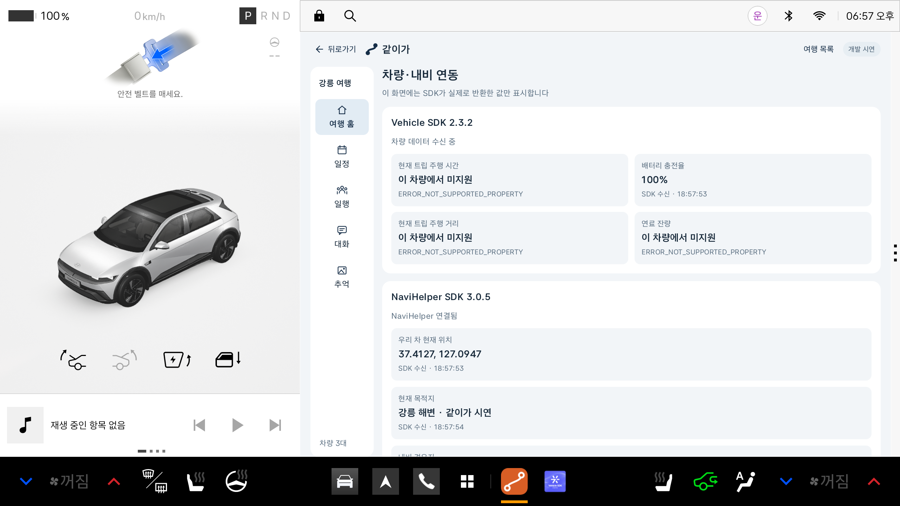
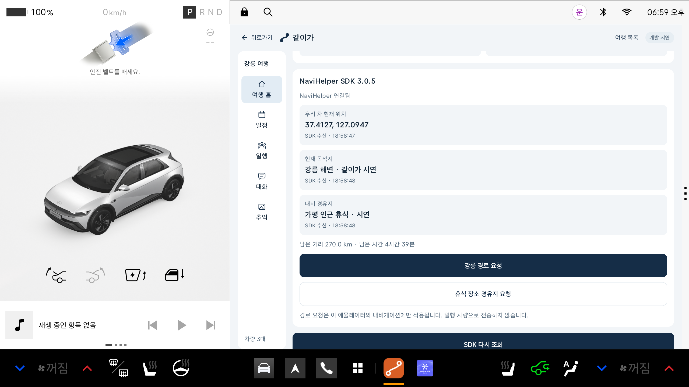

# 같이가 — 차량 SDK 연동과 로컬 일행 지도

작성일: 2026-10-28

2026-10-30 디자인 업데이트: 사용자 제공 Pleos Connect 2.1.5 원본 기준의 서체·색상·컴포넌트를 적용했습니다.
최신 UI와 검증 결과는 [디자인 적용 기준](design/pleos-215.md)에 기록합니다. 아래 기존 캡처는 당시 검증 기록입니다.

핵심 경험은 서로 다른 차를 타고도 같은 목적지를 향해 함께 여행하는 느낌입니다.
여행 홈·일정·일행·대화·휴식·추억 화면에서 우리 차·민수네·지연네와 목적지를 보는 지도를 유지합니다.
서버 없이 이 기기에서만 일행의 이동 장면을 재현합니다.

## 현재 연결한 SDK

| SDK | 앱 모듈 의존성 | 사용 범위 |
|---|---|---|
| Vehicle 2.3.2 | `ai.pleos.playground:Vehicle:2.3.2` | 트립 주행 시간·거리, EV 충전율, 연료 잔량 조회 |
| NaviHelper 3.0.5 | `ai.pleos.playground:NaviHelper:3.0.5` | 현재 위치·목적지·경유지 조회, 사용자 버튼으로 목적지·경유지 요청 |
| MapLibre Native 11.11.0 | `org.maplibre.gl:android-sdk:11.11.0` | 앱 안의 도로 지도 렌더링·차량 마커·카메라 이동 |

적용 모듈은 `:travel-preview`입니다. 기존 공식 SDK 샘플 `:app`은 변경하지 않았습니다.
위치·음성 SDK, AI, 일행 공유 서버, 실제 차량 간 통신은 추가하지 않았습니다.
직접 `.aar`를 복사하지 않고 공식 Maven 의존성을 사용합니다. 하위 의존성은 Gradle이 관리합니다.

Manifest 권한:

- `pleos.car.permission.CAR_DRIVE`
- `pleos.car.permission.CAR_ENERGY`
- `pleos.car.permission.NAVI_ROUTE`
- `pleos.car.permission.NAVI_ROUTE_SEARCH`
- `android.permission.INTERNET` — HTTPS 지도 스타일·타일·글꼴 다운로드
- `android.permission.ACCESS_NETWORK_STATE` — 지도 라이브러리의 네트워크 상태 확인

차량의 물리적인 장치를 제어하는 Vehicle `set` API는 호출하지 않습니다.
내비 경로 요청은 사용자가 버튼을 눌렀을 때만 수행합니다.

## 일행 지도

- **예시 여행 열기 → 여행 홈**에서 확인합니다.
- 넓은 창은 지도 오른쪽, 좁은 창은 지도 아래에서 일정·일행·대화·추억 패널을 엽니다. 탭 전환 시 지도 인스턴스를 유지합니다.
- 지도의 세 차량과 시연 경로는 기본적으로 로컬 시뮬레이션입니다. 실제 다른 차량의 위치가 아닙니다.
- 배경은 OpenFreeMap의 실제 도로 지도입니다. 점선은 서울~강릉 개발용 이동선이며 도로를 따라 계산된 경로가 아닙니다. 실제 길 안내로 사용할 수 없습니다.
- **일행 전체**는 시작 지점·세 차량·목적지가 보이도록 카메라를 맞춥니다. **우리 차 중심**은 우리 차 부근을 확대합니다.
- 시작 지점·전체 일행·목적지를 함께 포함하는 범위를 계산합니다.
- 여행 홈의 설정에서 **2분 자동**이 켜져 있으면 화면 사용 중 120초마다 시뮬레이션 위치를 갱신하고 전체 일행을 보여줍니다.
- **지금 갱신**을 누르면 즉시 다음 위치로 움직이며 SDK도 다시 조회합니다.
- 위치 변경은 4초 동안 부드럽게 표시합니다. 다음 갱신까지의 시간과 갱신 횟수를 표시합니다.
- **시연 처음부터**로 이동 장면을 초기화합니다.
- **우리 차 내비 위치**를 켜면 우리 차만 실제 NaviHelper 조회 좌표를 사용합니다. 위치가 수신됐을 때만 사용할 수 있습니다. 나머지 두 차는 계속 시뮬레이션입니다.
- 실제 위치를 선택한 뒤 조회에 실패하면 우리 차 마커를 숨기고 실패 사유를 표시합니다. 시연 좌표로 대신 표시하지 않습니다. 선택을 끄면 로컬 시연으로 돌아올 수 있습니다.
- 일행 데이터·차량 좌표를 공유 서버에 업로드하지 않습니다. 지도 제공자에는 표시 범위에 해당하는 타일 요청이 전송되므로 완전한 오프라인 앱은 아닙니다.
- 지도 로드 중·실패·응답 시간 초과를 표시하고 **지도 다시 불러오기**로 재시도합니다. 지도 아래 출처 표시를 누르면 제공자와 원문 링크를 확인할 수 있습니다.

### 실제 길 안내와의 구분

현재 기능은 주차 상태의 개발 시연입니다. 지도 렌더링과 차량 상태 조회가 실제로 동작하며, 경로 계산·회전 안내·재탐색·음성 안내를 수행하는 내비게이션 엔진은 아직 없습니다.
기본 내비로 경로를 보내는 버튼은 **차량·내비 연동 보기**의 진단 화면에서만 사용합니다. 일반 여행 화면의 탭은 앱 안에서 패널을 전환합니다.
목적지의 남은 거리·시간은 기본 내비가 SDK로 반환한 조회값이며 지도 점선의 계산 결과가 아닙니다.
향후 실제 내비게이션을 구현할 때는 지도/경로 제공자 선정, `APP_MAPS` 카테고리, `CarAppFocusManager`를 통한 경로 소유권과 단일 안내 정책, 주행 중 UX 제한을 적용해야 합니다.

시연 위치와 실제 SDK 데이터는 별도로 관리합니다. 시연 진행률이 배터리·주행 시간·실제 내비 위치를 바꾸지 않습니다.

## 실제 SDK 값 확인

여행 홈의 기능 패널에서 **차량·내비 연동 보기**를 누릅니다.

| 항목 | 공개 API | 공식 배포 소스에서 확인한 단위 |
|---|---|---|
| 현재 트립 주행 시간 | `checkTripCurrentDrivingTimeCapabilities`, `getTripCurrentDrivingTime`, `registerTripCurrentDrivingTime` | 분 |
| 현재 트립 주행 거리 | `checkTripCurrentDrivingDistanceCapabilities`, `getTripCurrentDrivingDistance` | m |
| 배터리 충전율 | `checkEvBatteryStateOfChargeCapabilities`, `getEvBatteryStateOfCharge` | % |
| 연료 잔량 | `checkFuelPercentCapabilities`, `getFuelPercent` | % |
| 현재 위치 | `getCurrentLocationInfo` → `onCurrentLocationInfo` | 위도·경도 |
| 목적지와 남은 거리·시간 | `getDestinationInfo` → `onDestinationInfo` | m, 초 |
| 경유지 목록 | `getWaypointInfo` → `onWayPointInfo` | 이름 목록 |

Vehicle 데이터는 capability 확인 후 조회합니다. 초기화 요청 반환만으로 조회 성공으로 표시하지 않습니다.
30초 주기로 다시 조회하며, 지원될 때 주행 시간 변경 알림을 등록합니다.
조회 중·성공·미지원·값 없음·오류를 구분하고, 미지원이나 실패 시 예시 숫자로 대체하지 않습니다.
일반 조회는 8초, 내비 초기 연결은 15초, 경로 처리 확인은 20초 제한을 두었습니다.
화면이 숨겨지면 타이머·리스너와 SDK 연결을 정리하고 다시 표시될 때 연결합니다.

### 현재 AVD에서 확인한 결과

Pleos Connect 2.1.0 / Android 14 / Vehicle Service 2.3.22 기준입니다.

- Vehicle의 배터리 충전율 **100%** 조회 성공.
- NaviHelper의 현재 위치 조회 성공.
- **강릉 경로 요청** 후 실제 Pleos Navigation 앱에 시연 목적지가 반영되는 것을 확인.
- 앱으로 돌아온 뒤 SDK가 반환한 남은 거리 **199,000m**, 남은 시간 **10,920초** 수신 확인. 화면에는 **199.0km / 3시간 2분**으로 표시.
- 현재 트립 주행 시간·트립 거리·연료는 이 AVD에서 `ERROR_NOT_SUPPORTED_PROPERTY` 응답. 미지원으로 표시하며 조회 성공으로 주장하지 않음.

- **휴식 장소 경유지 요청** 후 SDK 경유지 목록에서 **가평 인근 휴식 · 시연** 1개 수신 확인.
- 경유지 추가 뒤 남은 거리 **270,000m**, 시간 **16,740초** 수신 확인. 이 값은 시연 당시 내비 응답이며 고정값이 아닙니다.

경로 요청은 시연용 위경도와 이름을 사용합니다. 내비 앱이 앞으로 나오면 같이가 앱으로 돌아와 조회 결과를 확인할 수 있습니다.
실제 도로 안내와 경로 계산은 Pleos Navigation에서 처리하며, 로컬 일행 지도는 그 경로의 도로 형상을 복제하지 않습니다.

## 검증과 산출물

지도 범위 계산·경로 끝점·이름표 충돌 방지에 대한 JUnit 검증을 추가했습니다.
현재 Windows 한글 프로젝트 경로에서 Gradle Test Worker가 테스트 클래스를 찾지 못하는 문제가 있어,
동일하게 컴파일된 클래스를 영문 임시 경로에 복사한 뒤 JUnitCore로 실행해 검증합니다.
앱 APK 빌드는 기존 한글 프로젝트 경로에서 진행합니다.

- 지도 범위·경로 끝점·이름표 배치 테스트 **3개 통과**.
- 넓은 창 1682×1210, 실제 분할한 좁은 창 841×1210에서 일행 지도·메뉴·뒤로가기 확인.
- 수동 위치 갱신과 우리 차의 SDK 실제 위치 표시 확인.
- 120초 자동 갱신을 실제로 기다려 검증. 추가 조작 없이 갱신 횟수 1→2, 세 차량 진행률 45/33/59%→52/40/66% 변화 확인.

앱 안 도로 지도를 추가한 뒤 확인한 결과:

- debug APK 빌드, 에뮬레이터 설치·실행 성공.
- Lint 오류 0개. 기존 리소스·백업 설정과 버전 표기, 라이브러리의 로그 권고 등 경고 10개가 있으며 빌드를 막지 않습니다.
- 넓은 창의 옆 패널과 좁은 창의 아래 패널에서 일행·대화·일정·휴식 전환 및 뒤로가기 확인.
- 지도 타일·세 차량·목적지 표시, 수동 갱신, SDK 위치 전환, 배터리 100% 조회 유지 확인.
- 실제 위치 조회 실패 시 시연 좌표로 대체하지 않는 검증을 추가해 JUnit **5개 통과**. 앞의 3개 기하 검증을 포함한 수치입니다.
- MapView 내용이 UI Automator 덤프에 누락되는 경우가 있어 최종 지도·마커 표시는 실제 스크린샷으로 확인했습니다. 최종 앱 실행의 AndroidRuntime 오류 로그는 없었습니다.

- APK: `travel-preview/build/outputs/apk/debug/travel-preview-debug.apk`
- 개발용 debug APK이며 제출용 release APK가 아닙니다.
- 소스·문서·화면 캡처는 사용자 요청으로 GitHub `main`에 반영합니다. 앱 배포와 제출용 release 발행은 별도입니다.

공식 문서:

- [Vehicle SDK 설정](https://document.pleos.ai/docs/pleos-only/connect-sdk-pleos/Vehicle/project-setup)
- [Odometer API](https://document.pleos.ai/docs/pleos-only/connect-sdk-pleos/Vehicle/vehicle/ai.pleos.playground.vehicle.api/odometer/entry)
- [NaviHelper 연결](https://document.pleos.ai/docs/pleos-only/connect-sdk-pleos/NaviHelper/initialization-and-release)
- [NaviHelper 권한](https://document.pleos.ai/docs/pleos-only/connect-sdk-pleos/NaviHelper/declaring-permissions)
- [주행 UX 제한](https://document.pleos.ai/docs/pleos-only/vehicle-app-developer-guide/driving-restriction-development-guide)
- [Maps/Navigation 개발 정책](https://document.pleos.ai/docs/pleos-only/vehicle-app-developer-guide/navigation-app-development-guide)
- [MapLibre Native](https://github.com/maplibre/maplibre-native)
- [OpenFreeMap 모바일 지도와 출처](https://openfreemap.org/quick_start/)
