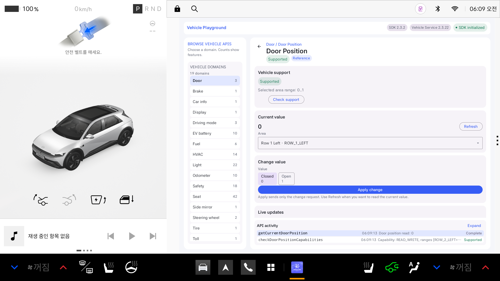

# 개발 환경 분석 및 상태 조회 구현 계획

점검일: 2026-10-27

분석 기준 원본은 공식 저장소의 `main`, 커밋 `959981d960ec71144accb27af5ae5d341e72a644`입니다.
초기 분석 이후 사용자 요청에 따라 Vehicle SDK 의존성을 2.3.2로 수정하고 한글 경로 빌드 설정을 추가했습니다.
Kotlin 코드와 Manifest는 원본 그대로이며, 아래 새 조회 화면 구현 내용은 계획입니다.

## 1. 프로젝트 구조와 버전

단일 Android 애플리케이션 모듈 `:app`으로 구성됩니다. Kotlin, Jetpack Compose, ViewModel, StateFlow를 사용합니다.

```text
공모전/
├─ settings.gradle.kts            저장소 설정, :app 등록
├─ build.gradle.kts               플러그인 별칭 등록
├─ gradle/libs.versions.toml      Kotlin·AGP·Vehicle SDK 버전
├─ gradle/wrapper/                Gradle wrapper
└─ app/
   ├─ build.gradle.kts            Android SDK·Java 설정
   └─ src/main/
      ├─ AndroidManifest.xml     공개 차량 권한, 시작 Activity
      └─ java/ai/pleos/playground/sample/vehicle/
         ├─ MainActivity.kt      Compose와 사용자 동작 연결
         ├─ MainViewModel.kt     조회 요청, 결과와 오류 상태 관리
         ├─ vehicle/             SDK 수명 관리, Door Position 직접 호출
         ├─ explorer/            공개 API 탐색과 리플렉션 호출
         └─ ui/                  화면 상태, Compose 화면과 테마
```

| 항목 | 실제 소스에서 확인한 값 | 확인 위치 |
|---|---|---|
| Kotlin / Compose 플러그인 | 2.0.0 | `gradle/libs.versions.toml` |
| Android Gradle Plugin | 8.8.2 | 같은 파일 |
| Gradle wrapper | 8.10.2 | `gradle/wrapper/gradle-wrapper.properties` |
| Vehicle SDK 의존성 | **2.3.2** | `gradle/libs.versions.toml`의 `vehicleSdk` |
| compileSdk / targetSdk | 35 / 35 | `app/build.gradle.kts` |
| 샘플 minSdk | 23 | 같은 파일 |
| Java / Kotlin JVM target | 17 / 17 | 같은 파일 |
| Compose BOM | 2024.04.01 | `gradle/libs.versions.toml` |
| 앱 ID / namespace | `ai.pleos.playground.sample.vehicle` | `app/build.gradle.kts` |
| 앱 버전 | 1.0.0-sdk35 | 같은 파일의 버전 계산식 |

공식 Maven 저장소는 `settings.gradle.kts`에 이미 등록되어 있습니다.

`https://nexus-playground.pleos.ai/repository/maven-releases/`

샘플의 minSdk 23과 제품 앱 배포 요구사항은 다릅니다. 공식 튜토리얼은 배포할 제품 앱에 API 28 이상의 요구사항을 별도로 적용하도록 안내합니다. 현재 샘플 값은 변경하지 않았습니다. [공식 튜토리얼](https://document.pleos.ai/docs/pleos-only/tutorial/vehicle-sdk-sample-app)

### 실제 환경 점검과 빌드 결과

| 항목 | 확인 결과 |
|---|---|
| JDK | `D:\PleosDev\jdk-17`, Temurin 17.0.20.1 |
| Android SDK | `D:\PleosDev\Sdk` |
| 설치된 Platform / Build Tools | API 34·35 / 34.0.0·35.0.0 |
| Emulator | 37.2.12.0 |
| AVD | `Pleos_Connect_2_1`, Pleos Connect 2.1.0, API 34, x86_64 |
| AVD 화면 설정 | 2560×1440, density 160, 메모리 4096MB |
| 가속 | `emulator -accel-check` 결과 0, WHPX 사용 가능 |
| 실행 중인 기기 | `emulator-5554`, 부팅 완료 |
| Vehicle Service | 2.3.22, 설치된 패키지와 앱 화면에서 확인 |

초기 원본 빌드에서 다음 두 문제가 확인됐습니다.

- 첫 실행은 Windows 한글 프로젝트 경로 검사로 실패했습니다. 명령행에 `-Pandroid.overridePathCheck=true`를 전달하면 해당 검사를 통과했습니다.
- 두 번째 실행은 `:app:checkDebugAarMetadata` 단계에서 `Could not find ai.pleos.playground:Vehicle:2.3.1`로 실패했습니다. 해당 버전의 공식 POM 요청도 HTTP 404였습니다. Maven 메타데이터는 2.0.3과 2.3.2를 나열하고 최신 release를 2.3.2로 안내합니다.

수정 내용은 `gradle/libs.versions.toml`의 SDK 버전 `2.3.1 → 2.3.2`와, `gradle.properties`의 `android.overridePathCheck=true` 추가입니다. 이 경로 옵션은 검사 생략 설정이며 모든 도구의 한글 경로 호환성을 보장하지는 않습니다. 현재 환경에서는 추가 명령행 옵션 없이 APK 빌드 성공을 확인했습니다.

수정 후 의존성 다운로드, Kotlin/Java 컴파일, APK 생성이 성공했습니다. Pleos AVD에 설치한 앱에서 `checkDoorPositionCapabilities`와 `getCurrentDoorPosition`의 실제 성공 응답도 확인했습니다. 다른 라이브러리와 AGP 버전은 변경하지 않았습니다. [공식 SDK 의존성 안내](https://document.pleos.ai/docs/pleos-only/connect-sdk-pleos/Vehicle/project-setup), [공식 Maven 메타데이터](https://nexus-playground.pleos.ai/repository/maven-releases/ai/pleos/playground/Vehicle/maven-metadata.xml)

검증 APK는 `app/build/outputs/apk/debug/app-debug.apk`이며 크기는 11,000,462바이트입니다. SHA-256은 `b03874f8843bbbff7581c0a59bf437c5b3b6681501cb01bed65472c221423b6c`입니다. debug APK이므로 제출용 release APK와 구분합니다.

## 2. 기존 차량 데이터 조회 코드의 위치

아래 경로는 `app/src/main/java/ai/pleos/playground/sample/vehicle/`를 기준으로 합니다.

| 파일과 함수 | 역할 |
|---|---|
| `vehicle/VehicleClient.kt:41`, `initialize()` | `Vehicle.initialize()` 실행과 동기 예외 처리 |
| `vehicle/VehicleClient.kt:87`, `DoorPositionRequests` | Door Position의 실제 typed SDK 호출을 모은 클래스 |
| `vehicle/VehicleClient.kt:99`, `inspectDoorPositionCapabilities()` | `checkDoorPositionCapabilities`로 접근 방식과 영역별 범위 확인 |
| `vehicle/VehicleClient.kt:115`, `readDoorPosition()` | `getCurrentDoorPosition`으로 선택 영역의 현재값 조회 |
| `vehicle/VehicleClient.kt:132`, `startDoorPositionUpdates()` | 변경 알림 등록 |
| `vehicle/VehicleClient.kt:143`, `stopDoorPositionUpdates()` | 등록했던 영역과 Listener로 해제 |
| `MainViewModel.kt:118`, `selectFeature()` | 기능에 들어갈 때 capability 확인 시작 |
| `MainViewModel.kt:164`, `runFeatureRead()` | 화면의 Refresh 요청 처리 |
| `MainViewModel.kt:297`, `onDoorPositionRead()` | 조회 결과를 `currentPosition`과 기능별 표시 상태에 저장 |
| `MainViewModel.kt:442`, `onError()` | API 실패 상태와 오류 메시지 기록 |
| `MainViewModel.kt:457`, `onDoorOperationError()` | Door 작업별 실패 처리 |
| `MainViewModel.kt:501`, `onCleared()` | 탐색기 구독과 Vehicle 세션 정리 |
| `ui/data/MainUiState.kt` | 조회값, 기능 결과, 오류 메시지 상태 |
| `ui/screen/FeatureControlPane.kt:159`, `CurrentValueSection()` | 현재값 및 Refresh 버튼 표시 |
| `MainActivity.kt:21` | `collectAsStateWithLifecycle()`로 화면 상태 구독 |

실제 데이터 전달 흐름은 다음과 같습니다.

```text
화면의 Refresh
  → MainViewModel.runFeatureRead()
  → invokeTypedDoorApi()
  → VehicleClient.readDoorPosition()
  → Door.getCurrentDoorPosition()
  → onComplete / onFailed
  → MainUiState 갱신
  → Compose의 Current value 갱신
```

`explorer/VehicleApiExplorer.kt`는 여러 도메인의 메서드를 리플렉션으로 탐색·호출하는 진단용 구조입니다. 여행 앱의 새 기능은 Door 예제처럼 필요한 typed API를 직접 호출하는 방식으로 설계합니다.

기존의 `isInitialized=true`는 `initialize()` 호출이 예외 없이 반환됐다는 뜻입니다. Service 연결이나 개별 속성 조회 성공의 증거로 사용하지 않습니다. 실제 capability와 GET 결과를 확인해야 합니다.

## 3. 공식 공개 API와 필요한 조회 권한

아래는 이번 첫 기능과 여행 앱의 후속 기능에 관련된 공개 API입니다. 공식 문서의 이름과 실제 배포된 **Vehicle 2.3.2 AAR의 메서드·RequiresPermission 어노테이션**을 대조했습니다. 현재 프로젝트 의존성도 같은 2.3.2입니다. 모든 기능을 AVD에서 실행해 검증한 것은 아닙니다.

| 데이터 / 작업 | 정확한 API 이름 | 조회·구독 권한 |
|---|---|---|
| 문 위치 지원 범위 | `Door.checkDoorPositionCapabilities` | `pleos.car.permission.CAR_DOORS` |
| 문 위치 현재값 | `Door.getCurrentDoorPosition` | 같은 권한 |
| 문 위치 변경 알림 | `Door.registerDoorPosition` | 같은 권한 |
| 문 위치 알림 해제 | `Door.unregisterDoorPosition` | 같은 권한 |
| 문 잠금 현재값 | `Door.getDoorLockState` | 같은 권한 |
| 누적 주행 거리 | `Odometer.getCurrentDistanceDriven` | `pleos.car.permission.CAR_DRIVE` |
| 현재 트립 주행 시간 | `Odometer.getTripCurrentDrivingTime` | 같은 권한 |
| 누적 트립 주행 시간 | `Odometer.getTripCumulativeDrivingTime` | 같은 권한 |
| EV 배터리 충전 상태 | `EvBattery.getEvBatteryStateOfCharge` | `pleos.car.permission.CAR_ENERGY` |
| 브레이크 페달 작동 상태 | `Brake.getCurrentBrakePedalStatus` | `pleos.car.permission.CAR_DRIVE` |

`checkDoorPositionCapabilities`는 콜백이 `(config, areaBounds)`를 받는 현재 오버로드를 기준으로 합니다. 옛 오버로드는 deprecated이므로 새 구현에 사용하지 않습니다.

관련 공식 명세: [Door](https://document.pleos.ai/docs/pleos-only/connect-sdk-pleos/Vehicle/vehicle/ai.pleos.playground.vehicle.api/door/entry), [Odometer](https://document.pleos.ai/docs/pleos-only/connect-sdk-pleos/Vehicle/vehicle/ai.pleos.playground.vehicle.api/odometer/entry), [EvBattery](https://document.pleos.ai/docs/pleos-only/connect-sdk-pleos/Vehicle/vehicle/ai.pleos.playground.vehicle.api/ev-battery/entry), [Brake](https://document.pleos.ai/docs/pleos-only/connect-sdk-pleos/Vehicle/vehicle/ai.pleos.playground.vehicle.api/brake/entry).

배포 AAR 확인 근거:

- 주소: `https://nexus-playground.pleos.ai/repository/maven-releases/ai/pleos/playground/Vehicle/2.3.2/Vehicle-2.3.2.aar`
- SHA-256: `e11fdfe498cad3ecc0d5a2a6992b0c4a4d135195f1455018127bc069fd5ef937`
- 위 목록의 메서드 이름, 콜백 반환 타입, 권한 어노테이션을 JDK `javap`로 확인했습니다. AAR 자체를 프로젝트나 GitHub에 추가하지 않았습니다.

이 표는 전체 API 목록이 아닌 우선 검토할 조회 API 목록입니다. 전체 도메인과 명세는 [공식 API Reference](https://document.pleos.ai/docs/pleos-only/connect-sdk-pleos/Vehicle/vehicle/ai.pleos.playground.vehicle.api/entry)에서 확인할 수 있습니다. SDK에 이름이 존재해도 현재 AVD·차량에서 지원된다는 보장은 없으므로 각각 capability를 확인해야 합니다.

현재 샘플의 Manifest에는 조회 권한과 제어 권한이 함께 선언되어 있습니다. 원본 보존을 위해 아직 삭제하지 않았습니다. 문 위치를 조회·구독하는 첫 기능에 필요한 차량 권한은 `CAR_DOORS`이며, 제어 API나 `CONTROL_CAR_DOORS`를 사용할 이유는 없습니다. [공식 권한 안내](https://document.pleos.ai/docs/pleos-only/connect-sdk-pleos/Vehicle/vehicle-permission)

브레이크 페달 상태 하나로 주행·정차를 판정하거나, 트립 주행 시간을 곧바로 마지막 휴식 이후 연속 운전 시간으로 해석하지 않습니다. 시간·거리의 단위와 초기화 기준은 후속 기능 구현 전에 추가 확인합니다. 현재 샘플의 공개 도메인 목록에서 확인하지 못한 기어·속도 API 이름을 임의로 추가하지 않습니다.

## 4. 차량 상태 하나를 표시하는 구현 계획

첫 데이터는 기존 typed 예제를 재사용할 수 있는 **앞줄 왼쪽 문 위치**로 정합니다.

조회 영역은 공식 예제의 `DoorArea(DoorValue.ROW_1_LEFT)`입니다. 이 영역을 실제 차량의 운전석과 항상 동일하다고 가정하지 않습니다.

1. 기존 Vehicle 세션을 재사용하고 초기화의 동기 예외를 처리합니다.
2. `checkDoorPositionCapabilities`가 성공한 뒤, `AccessType.READ` 또는 `READ_WRITE`인지 확인합니다.
3. 반환된 `areaBounds`에 선택한 영역이 있는지 확인합니다. 기능 전체 미지원과 선택 영역 미지원은 구분합니다.
4. 그 성공 콜백에서 `getCurrentDoorPosition`을 한 번 호출합니다. 두 비동기 요청을 동시에 시작하지 않습니다.
5. 결과를 ViewModel의 화면 상태로 전달하고 Compose에 표시합니다. 초기값 0을 실제 조회값처럼 표시하지 않습니다.
6. 첫 단계는 수동 Refresh로 검증합니다. 이후 실시간 표시가 필요해지면 `DoorPositionListener` 구독을 추가합니다.
7. 구독을 추가한 경우 같은 Listener 인스턴스와 영역으로 해제한 뒤 Vehicle 세션을 정리합니다.

기존 샘플은 이미 `Current value`에 원본 조회값을 표시하는 흐름을 갖고 있습니다. 이 흐름을 먼저 검증한 뒤, 향후 별도 기능 브랜치에서 읽기 전용 표시 영역을 추가합니다. 기존 탐색 화면과 호출 코드는 교체하지 않습니다.

화면 상태는 최소 다음을 구분하도록 계획합니다.

| 상태 | 표시 예 |
|---|---|
| 초기화·지원 확인·조회 진행 | 차량 정보를 확인하는 중… |
| 정상 결과 | 앞줄 왼쪽 문: 닫힘 / 열림, 원본값과 마지막 수신 시각 |
| 성공 콜백의 null | 차량에서 현재값을 제공하지 않습니다 |
| 기능 또는 영역 미지원 | 이 차량은 해당 기능/영역 조회를 지원하지 않습니다 |
| 권한·Service·기타 오류 | 실패한 API 이름, 영역, 오류 코드가 있으면 코드, 원문 메시지와 재시도 |
| 일정 시간 응답 없음 | 응답 대기시간 초과 — 앱이 자체 판단한 타임아웃임을 구분 |

Door Position은 공식 예제처럼 capability가 0..1인 환경에서 닫힘/열림 표시를 검증합니다. 범위가 다른 환경이나 알 수 없는 값은 원본값을 표시하고 임의로 정상 상태로 바꾸지 않습니다. UI 범위나 단위도 고정 퍼센트로 추측하지 않습니다.

오류 처리에는 `onFailed(Exception)`을 사용합니다. 공식 안내에 따라 `VehicleException`인 경우에만 `errorCode`를 읽고, 일반 Exception도 별도 처리합니다. `ERROR_SECURITY_PERMISSION`, `ERROR_NOT_SUPPORTED_PROPERTY`, `ERROR_NOT_SUPPORTED_AREA`, `ERROR_SERVICE_CONNECTION_FAILURE` 등의 실제 오류를 구분합니다. [공식 오류 처리](https://document.pleos.ai/docs/pleos-only/connect-sdk-pleos/Vehicle/vehicle-error-code)

새 조회 실패 시 이전 값을 최신 성공값처럼 남겨두지 않습니다. 이전 값을 보관한다면 이전 수신값임을 표시하고 오류를 함께 유지합니다. 자체 타임아웃 뒤 늦게 도착한 콜백이나 이미 닫힌 화면의 응답도 요청 식별자로 구분할 계획입니다. 이 요청 관리 로직은 앱 내부 설계이며, 새로운 SDK API가 아닙니다.

## 5. 에뮬레이터 테스트 방법

다음은 샘플의 조회를 재현하고 상태 변경 반영을 후속 검증하는 절차입니다. 이번 점검에서는 앱 설치·실행·초기 Door Position 조회를 검증했습니다. Virtual Console로 상태를 바꾸는 테스트, Listener 구독, 오류 주입은 아직 실행하지 않았습니다.

1. 바탕화면의 Pleos Connect Emulator 바로가기로 `Pleos_Connect_2_1`을 실행합니다. 일반 Android 휴대전화 AVD에는 Pleos Vehicle Service가 없습니다.
2. `adb devices -l`로 기기 연결을 확인합니다.
3. JDK 17과 Android SDK 경로를 설정한 터미널에서 debug APK를 빌드·설치합니다. 한글 경로 검사 설정은 `gradle.properties`에 반영되어 있습니다.

```powershell
$env:JAVA_HOME = 'D:\PleosDev\jdk-17'
$env:ANDROID_HOME = 'D:\PleosDev\Sdk'
$env:GRADLE_USER_HOME = 'D:\PleosDev\gradle'
$env:ANDROID_USER_HOME = 'D:\PleosDev\android-user'
$env:ANDROID_AVD_HOME = 'D:\PleosDev\avd'

Set-Location -LiteralPath 'C:\Users\82102\Desktop\공모전'
.\gradlew.bat assembleDebug
.\gradlew.bat installDebug

& 'D:\PleosDev\Sdk\platform-tools\adb.exe' devices -l
& 'D:\PleosDev\Sdk\platform-tools\adb.exe' forward tcp:8088 tcp:8088
```

4. 에뮬레이터의 앱 목록에서 **Vehicle SDK Sample → Door → Door Position**을 엽니다.
5. `Vehicle support`의 지원 범위와 `ROW_1_LEFT` 영역을 확인한 뒤 `Current value`의 `Refresh`를 누릅니다. `API activity`에서 실제 GET 응답을 함께 확인합니다.
6. PC 브라우저에서 `http://127.0.0.1:8088/`를 엽니다. Virtual Console의 **Emulation Controls → Convenience → Door Position**에서 같은 영역을 열림/닫힘으로 바꿉니다.
7. 앱의 Refresh로 변경된 값을 다시 조회합니다. Listener를 검증하는 후속 단계에서는 실제 변경 알림 수신과 해제 후 미수신을 따로 확인합니다.

앱에서는 SET API를 호출하지 않습니다. 테스트용 입력은 에뮬레이터 Virtual Console에서만 바꿉니다. 샘플의 `Apply change`는 이 조회 테스트에서 사용하지 않습니다.

| 확인 항목 | 통과 기준 |
|---|---|
| 기본 읽기 | capability와 GET 성공 응답, 표시값이 서로 일치 |
| 상태 변경 반영 | Virtual Console에서 같은 영역을 바꾼 뒤 Refresh 결과가 일치 |
| null·오류·미지원 | 정상값과 구분된 메시지 표시, 실패 시 이전 값의 신선도 표시 |
| 구독을 추가한 경우 | 실제 알림 수신 확인, 같은 Listener와 영역으로 해제 |
| 앱 수명 | 화면 재진입·종료 시 충돌과 중복 구독 없음 |
| 기존 샘플 유지 | 기존 기능 목록, Door Position 수동 조회가 계속 동작 |

AVD에서 자연스럽게 재현되지 않는 null·권한 오류·타임아웃은 후속 구현 때 테스트용 데이터 공급 계층으로 검증합니다. 정상 결과를 만들기 위해 실제 샘플 권한을 지우거나 임의의 SDK 호출을 추가하지 않습니다.

공식 절차: [Virtual Console 셋업](https://document.pleos.ai/docs/connect/guide/getting-started/application-development/use-vehicle-emulator), [Virtual Console 도메인별 테스트](https://document.pleos.ai/docs/pleos-only/app-test-guide/virtual-console-guide).

### 2026-10-27 수정 후 실제 검증 결과

- `assembleDebug`: 성공. 한글 경로 설정을 파일에 반영한 뒤 별도 `-P` 옵션 없이도 성공했습니다.
- APK 설치: `adb install -r` 성공.
- 앱 실행: `am start -W`가 `Status: ok`를 반환했습니다.
- 화면 버전: `SDK 2.3.2`, `Vehicle Service 2.3.22`.
- 조회 영역: `ROW_1_LEFT`.
- capability: `READ_WRITE`, 선택 영역 범위 `0..1`.
- GET: `Door position read: 0`, `Complete`, Current value `0`.
- 제어 요청은 보내지 않았고 변경 알림 구독도 시작하지 않았습니다.



최종 확인 범위는 SDK 의존성 문제 해결, 샘플 빌드·설치·실행과 Door Position 초기 조회입니다. 모든 차량 API의 지원 여부, 실차 동작, 상태 변경 알림이나 실패 처리 전체를 검증한 것은 아닙니다. 새 상태 조회 화면은 아직 구현하지 않았습니다.
