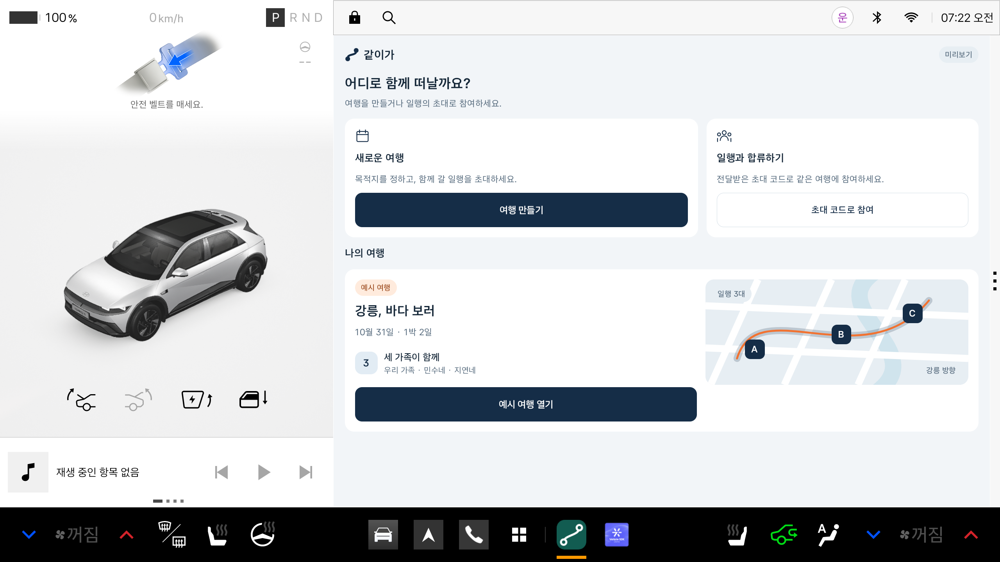
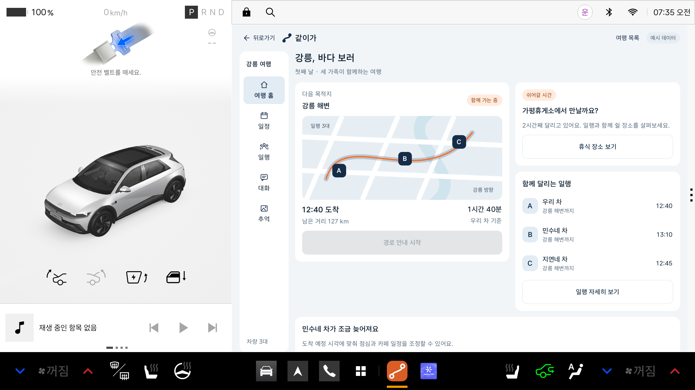
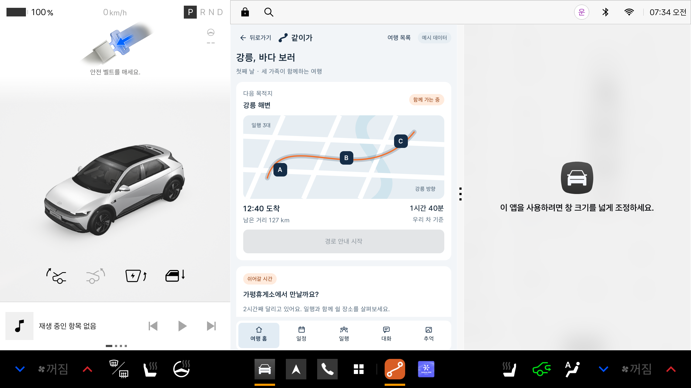
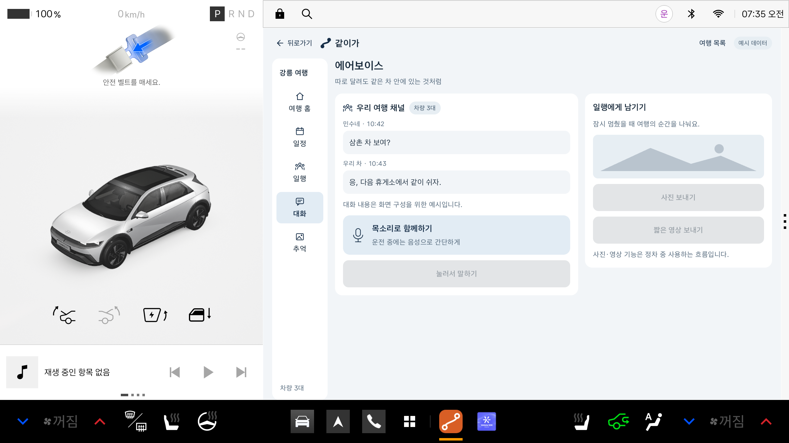

# 같이가 앱 화면 미리보기

> 2026-10-28: Vehicle·NaviHelper 연동과 로컬 일행 지도 시뮬레이션을 추가했습니다.
> 최신 기능·조회 결과·사용법은 [차량 연동과 로컬 일행 지도](같이가_차량연동과_로컬일행지도.md)를 참고하세요.
> 아래의 화면 전용 구성 설명과 스크린샷은 그 이전 시안 기록입니다.

기획 자료의 내용을 실제 사용자가 이용할 여행 앱의 화면 흐름으로 옮겼습니다.
앱 이름은 **같이가 미리보기**, 패키지는 `com.contest.travel.preview`입니다.
기획서의 단계별 소개·문제 정의 화면을 재현하지 않습니다.

현재는 **화면 이동만 가능한 네이티브 Android UI 시안**입니다.
여행 생성, 초대 코드 입력, AI 계획, 위치 공유, 무전, 사진·영상, 휴식 제안, 일정 적용, 앨범 기능은 연결하지 않았습니다.
화면의 날짜·차량·장소·경로·도착 시각·대화는 정적인 예시 데이터입니다. 지도는 코드로 그린 배치 예시입니다.

## 앱의 화면 흐름

| 진입 화면 | 화면 구성과 이동 |
|---|---|
| 첫 화면 | 여행 만들기, 초대 코드로 참여, 예시 여행 열기 |
| 여행 만들기 | 이름·목적지·출발일·출발지 입력 영역. 입력과 생성 버튼은 미구현 |
| 초대 코드로 참여 | 코드 입력 영역과 비활성 참여 버튼 |
| 여행 홈 | 다음 목적지·경로·도착 예정, 일행 상태, 휴식 장소 및 일정 변경안으로 이동 |
| 일정 | 여행 일정, 일행이 하고 싶은 것, 변경안으로 이동 |
| 일행 | 차량 위치 배치와 도착 예정 시각, 일행 초대 화면으로 이동 |
| 대화 | 에어보이스 대화 예시, 음성·사진·영상 버튼 |
| 추억 | 여행 경로와 사진·음성 기록 영역, 앨범 생성·공유 버튼 |
| 휴식 장소 | 공통 휴게소와 차량별 도착 시간 배치 |
| 일정 변경안 | 지연 상황과 변경 전후 일정 비교 |
| 일행 초대 | 초대 코드 영역과 발급·공유 버튼 |

처음에는 **예시 여행 열기**를 눌러 여행 홈으로 이동합니다.
여행 안에서는 **여행 홈 / 일정 / 일행 / 대화 / 추억** 메뉴로 화면을 바꿉니다.
넓은 창에는 왼쪽 메뉴, 좁은 창에는 하단 메뉴를 표시합니다.
상단 왼쪽 **뒤로가기** 버튼은 이전 화면으로 돌아갑니다. 첫 화면에서는 표시하지 않습니다.
상단 **여행 목록** 버튼은 바로 첫 화면으로 돌아갑니다.

앱 버튼과 Android 뒤로가기는 같은 이동 기록을 사용합니다.
상세 화면에서는 진입한 화면으로 돌아갑니다. 예를 들어 변경안을 홈에서 열었으면 홈으로, 일정에서 열었으면 일정으로 돌아갑니다.
여행의 주요 메뉴에서 뒤로가면 여행 홈으로, 여행 홈에서 뒤로가면 첫 화면으로 돌아갑니다.
실제 서비스 동작을 하는 버튼은 비활성화했습니다.
화면 상태는 페이지 이동 기록과 스크롤 위치만 관리하며 입력·계산·저장·녹음·통신 로직은 없습니다.

## 에뮬레이터에서 보기

1. Pleos Connect 에뮬레이터를 실행합니다.
2. 하단 앱 목록을 엽니다.
3. **같이가 미리보기**를 누릅니다.
4. **예시 여행 열기**로 여행 홈을 확인합니다.
5. 시스템의 창 크기 조절 손잡이로 좁은 창에서도 확인할 수 있습니다.

실제 Pleos의 Driving view·상태바·GNB는 유지하고, 시스템이 배정한 Activity 창 안에 앱을 표시합니다.
별도의 가짜 차량 화면을 앱 안에 그리지 않습니다.







분할 화면의 왼쪽이 같이가 앱입니다. 오른쪽의 창 크기 안내는 함께 열린 Pleos 기본 차량 앱에서 표시한 것입니다.



## 확인 결과

2026-10-27, Pleos Connect 2.1.0 / Android 14 AVD에서 확인했습니다.

- `:travel-preview:assembleDebug`, 기존 `:app:assembleDebug` 모두 성공.
- APK 업데이트 설치와 실행 성공.
- 여행 만들기·참여·홈·일정·일행·대화·추억·휴식·변경안·초대 화면 진입 확인.
- 생성·참여·경로 안내·위치 공유·무전·휴식 제안·일정 적용·앨범 버튼 비활성화 확인.
- 넓은 앱 창 1682×1210, 실제 분할한 앱 창 841×1210에서 배치와 메뉴 전환 확인.
- 좁은 창의 하단 메뉴로 일정·대화 화면 이동 확인.
- 상단 뒤로가기: 만들기·참여→첫 화면, 휴식→홈, 변경안→진입한 홈/일정, 초대→일행, 주요 메뉴→홈, 홈→첫 화면 확인.
- 좁은 창에서도 뒤로가기 버튼 표시와 일정→홈 복귀 확인. 첫 화면에서는 버튼을 숨김.

이 크기는 현재 AVD에서 실측한 앱 창 크기이며 모든 차량에 공통인 규격이 아닙니다.

## 소스와 APK

- 기존 `:app`: 공식 Vehicle SDK 샘플. 이번 UI 작업에서 코드·Manifest·SDK 버전을 변경하지 않았습니다.
- `:travel-preview`: Kotlin·Jetpack Compose로 만든 독립적인 앱 모듈.
- compileSdk / targetSdk 35, minSdk 28, JDK 17.
- APK 위치: `travel-preview/build/outputs/apk/debug/travel-preview-debug.apk`.
- 현재 APK는 화면 검토용 debug 빌드입니다. 제출용 서명 release APK는 이후 만들 수 있습니다.

```powershell
$env:JAVA_HOME = 'D:\PleosDev\jdk-17'
$env:ANDROID_HOME = 'D:\PleosDev\Sdk'
$env:GRADLE_USER_HOME = 'D:\PleosDev\gradle'
Set-Location -LiteralPath 'C:\Users\82102\Desktop\공모전'
.\gradlew.bat :travel-preview:assembleDebug
.\gradlew.bat :travel-preview:installDebug
```

## 화면과 차량 환경에 적용한 사항

- dp·sp 단위와 창 너비 기준 배치. 고정된 전체 디스플레이 비율에 맞추지 않음.
- 밝은·어두운 시스템 테마에 대응하는 색상.
- 시스템 sans-serif, 보조 정보 20sp 이상, 주요 버튼 최소 높이 88dp.
  이 크기는 현재 UI에서 선택한 값이며 공식 문서의 고정 수치로 주장하지 않음.
- foreground/background를 분리한 adaptive app icon.
- 기존 AAOS `CarUxRestrictionsManager` 상태 확인 코드 유지.
  주행 제한 중이거나 상태를 확인할 수 없으면 화면 진입 버튼을 비활성화하고 안내 표시.
- 주행 중 사용을 허용하는 DO 메타데이터 없음.
- 차량 제어, 실제 차량 상태 조회, 위치, 마이크, 인터넷 권한과 서비스 기능을 새로 연결하지 않음.

현재는 주차 상태에서 앱 구성을 검토하는 시안입니다.
공식 설계 문서와 현재 에뮬레이터를 참고했으며 모든 차량과 정식 심사에 대한 적합성 검증을 의미하지 않습니다.

참고 문서:
[앱 구조](https://document.pleos.ai/docs/pleos-only/vehicle-app-planning-guide/app-structure-screen-model),
[레이아웃](https://document.pleos.ai/docs/connect/guide/docs-design/getting-started/layout),
[창 정책](https://document.pleos.ai/docs/connect/guide/docs-design/getting-started/window),
[글자](https://document.pleos.ai/docs/connect/guide/docs-design/foundations/typography),
[앱 아이콘](https://document.pleos.ai/docs/connect/guide/docs-design/foundations/contents-creation/app-icon),
[주행 제한](https://document.pleos.ai/docs/pleos-only/vehicle-app-developer-guide/driving-restriction-development-guide).

## 작업 범위

정보 배치·화면 전환·창 크기별 구성을 먼저 검토합니다. 기능 연결은 별도 요청 후 진행합니다.
현재 변경은 사용자 요청으로 `seojongwhi-ui/pleos-travel-app` 저장소의 `main`에 반영합니다.
