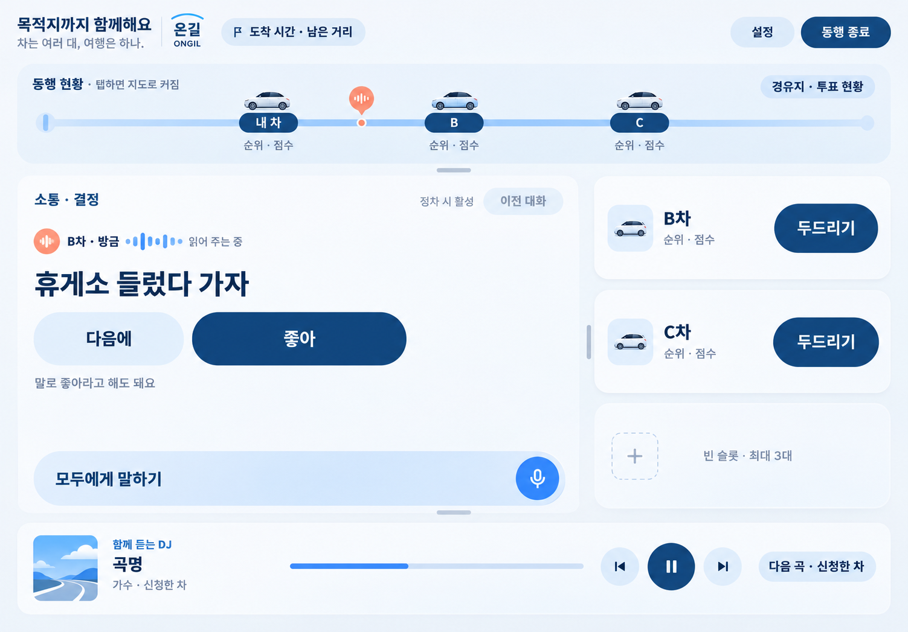

# 온길 기획·디자인 대화 정리

보관일: 2026-11-05

사용자 지정 저장 위치: **`seojongwhi-ui/pleos-travel-app` 저장소의 기존 `기획서` 브랜치**.

## 기록 바로가기

- [사용자 작성 기획서 원문](온길_기획서_사용자초안_20261105.md)
- [사용자와 Codex의 대화 기록](온길_대화기록_20261105.md)
- [Figma 원본 참조와 이미지 시안 3종](design/concepts/20261105-ongil/README.md)
- [실제 이미지 생성 프롬프트](design/concepts/20261105-ongil/이미지_생성프롬프트.md)
- [이미지 파일 지문과 출처](design/concepts/20261105-ongil/manifest.json)
- [앞서 정리한 기획 방향](기획_방향_20261104.md)

## 서비스의 중심

현재 기획서의 이름은 **온길 ONGIL**입니다. 친구들이 여러 대의 차량에 나눠 타도 이동 시간 전체를 하나의 여행으로 느끼게 하는 현대차 차량 내 디스플레이용 앱입니다. 기존 구현의 ‘같이가’ 명칭을 코드에서 변경하는 작업은 이번 기록에 포함하지 않았습니다.

대표 경험은 **실제 장소에 남겨진 친구의 목소리**입니다. 먼저 지나간 차량이 특정 장소에 짧은 음성을 남기고, 뒤따르는 차량이 같은 장소에 도착하면 메시지를 받아 원하는 시점에 듣습니다. 답장과 다른 차량의 참여로 그 장소에 이야기가 쌓입니다. 대화 중 휴식 제안을 인식하는 AI 음성 투표, 수락 후 시작하는 차량 간 두드리기 대화, 함께 듣는 음악은 연결을 돕는 기능으로 제안됐습니다.

핵심 문구는 **“어서 타!”**, **“길 위에서 이어지는 우리”**, **“차는 여러 대, 여행은 하나.”**입니다. 초안은 위치·경로 정보를 활용하는 경험과 음성 중심의 상호작용을 제안합니다. 기능의 구현 완료나 실제 SDK 지원 범위 검증을 뜻하지 않습니다. 현재 구현 상태는 기존 [개발 작업 안내](../START_HERE.md)와 개발 문서를 따릅니다.

초기 타깃은 여러 차량으로 함께 여행하는 20~30대 친구 그룹입니다. 초안의 MAU 6,000명은 월 1,000개 그룹 × 평균 6명이라는 가정에 기반한 목표이며, 6개월 내 재사용률 25%도 초기 목표입니다. 검증 결과로 취급하지 않습니다.

## 이번 대화에서 승인한 무드

**맑고 정돈된 블루 위에, 친구가 여행에 초대하는 경쾌함을 담습니다.** 떠올릴 장면은 주말 아침, 차 문을 열고 친구에게 “어서 타!”라고 말하는 순간입니다.

| 제안색 | 역할 | 지향하는 인상 |
|---|---|---|
| 쿨 화이트 `#F4F7FA` | 화면 바탕 | 맑은 공기, 출발하는 아침 |
| 딥 블루 `#17365D` | 주요 글자와 중심 요소 | 차량 화면의 안정감 |
| 스카이 블루 `#649BFA` | 음성·연결 상태와 포인트 | 열린 하늘, 가벼운 설렘 |
| 소프트 코랄 `#F69B82` | 작은 친구 메시지 표시 | 사람의 온기, 반가움 |

위 팔레트는 **온길의 무드 탐색 제안**입니다. 현대차·Pleos의 공식 지정색이나 저장소의 구현 토큰을 새로 정의한 값이 아닙니다. 구현 시에는 사용자가 제공한 [Pleos Connect 2.1.5 원본 기준](design/pleos-215.md)과 [추출 토큰](design/pleos-215-tokens.json)을 확인하고 적용 범위를 정해야 합니다.

그래픽은 부드러운 경로선, 차량 표식, 작은 장소 기반 음성 표시와 짧은 파형으로 구성합니다. 서로 다른 위치의 차량들이 같은 여행길로 이어져 보이도록 합니다. 가로로 펼쳐진 카드와 일정한 모서리, 넉넉한 여백을 사용합니다. 순위·점수의 시각적 비중을 낮추자는 것은 무드 설명 중의 제안이며, 기능 삭제나 와이어프레임 구조 변경을 확정한 기록은 아닙니다.

한국어를 주요 정보와 조작 문구에 사용하고 영어는 이름과 짧은 보조 문구에 제한합니다. 제안한 예시는 `온길 ONGIL`, `Together, on the way.`, 출발 화면의 `어서 타! Ready to go?`입니다. 주행 중 조작 문구는 `모두에게 말하기`, `같이 쉬어 갈까?`처럼 바로 이해되는 한국어를 중심으로 둡니다.

사용자는 이 무드 설명에 **“이오케이 만들어봐”**라고 답해 이미지 생성을 승인했습니다. 아래 이미지는 그 뒤 생성한 첫 무드 시안입니다. 완성 이미지의 최종 채택이나 앱 구현 승인을 별도로 받은 것은 아닙니다.

## Figma에서 확인한 범위

- 파일: [현대 공모전](https://www.figma.com/design/c3q0MskWTtRP5gE9WspRVo/현대-공모전?node-id=34-99038)
- 파일 키: `c3q0MskWTtRP5gE9WspRVo`
- 프레임: `34:99038`, S-10 **주행 중 메인 · 기본**, v0.3
- 화면 부분 참조 노드: `34:99065`, 1700 × 1184
- 전체 프레임: 3000 × 1840, 우측 기능 설명과 하단 상태·이벤트 설명 포함

상단의 동행 현황, 중앙 왼쪽의 소통·결정, 오른쪽의 B차·C차·빈 차량 슬롯, 하단 음악 영역을 읽어 이미지의 배치 기준으로 삼았습니다. 와이어프레임에 명시된 최근 말 1개 표시, 이전 대화의 정차 시 활성, 음성 입력과 TTS 등도 확인했습니다. 파일 전체의 모든 프레임을 가져온 것은 아닙니다.

## 탐색 과정과 보관 상태

1. Figma MCP 등록과 OAuth 로그인을 완료했습니다. 인증 정보는 Git에 보관하지 않습니다.
2. 사용자가 공유한 S-10 프레임을 읽고 전체/화면 PNG 참조를 확보했습니다.
3. 초기에는 아이보리·딥 틸, 차콜·민트 두 이미지를 비교했습니다. 이때의 야간 모드 제안은 최종 구현 결정이 아닙니다.
4. 사용자 기획서와 현대차 디스플레이라는 맥락을 받은 후, 블루·화이트·코랄 방향을 설명하고 승인을 받아 한 장을 생성했습니다.
5. 사용자 지시에 따라 기획서 원문, 공개 대화, 생성 프롬프트, 참조 이미지와 세 시안을 기존 `기획서` 브랜치에 함께 보관합니다.

Figma 원본 편집과 Android UI 구현은 수행하지 않았습니다. 생성 이미지의 문구·색상·서체·세부 규격은 실제 구현 전 검토해야 합니다.

## 무드 설명 때 확인한 공식 자료

- [Pleos Connect: 단순하고 일관된 화면 구성과 제한된 색상 사용](https://pleos.ai/service-solution/pleos-connect?locale=en-US)
- [현대자동차 디자인 철학과 디자인 요소](https://www.hyundai.com/worldwide/en/company/innovation/design)
- [Figma MCP에서 프레임 링크로 디자인을 지정하는 방법](https://help.figma.com/hc/en-us/articles/39216419318551-Get-started-with-the-Figma-MCP-server)

공식 자료는 방향을 해석할 때 참고했습니다. 이번 시안에 대한 공식 인증이나 규격 적합성 검증의 근거로 사용하지 않습니다.
