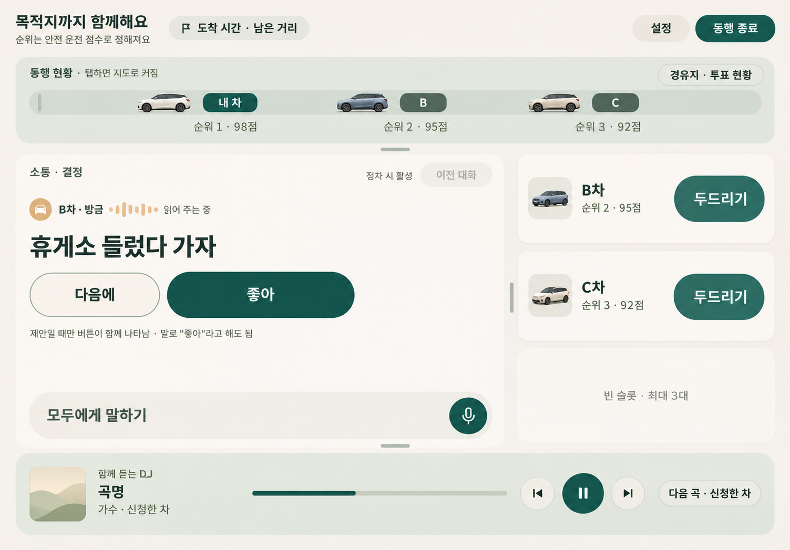
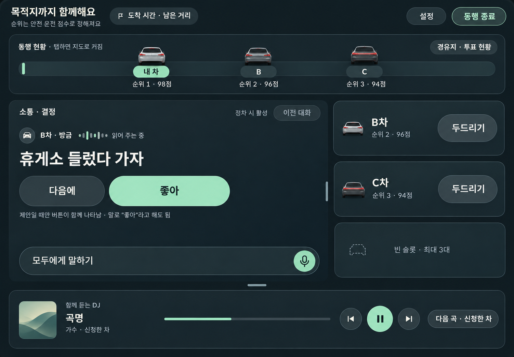
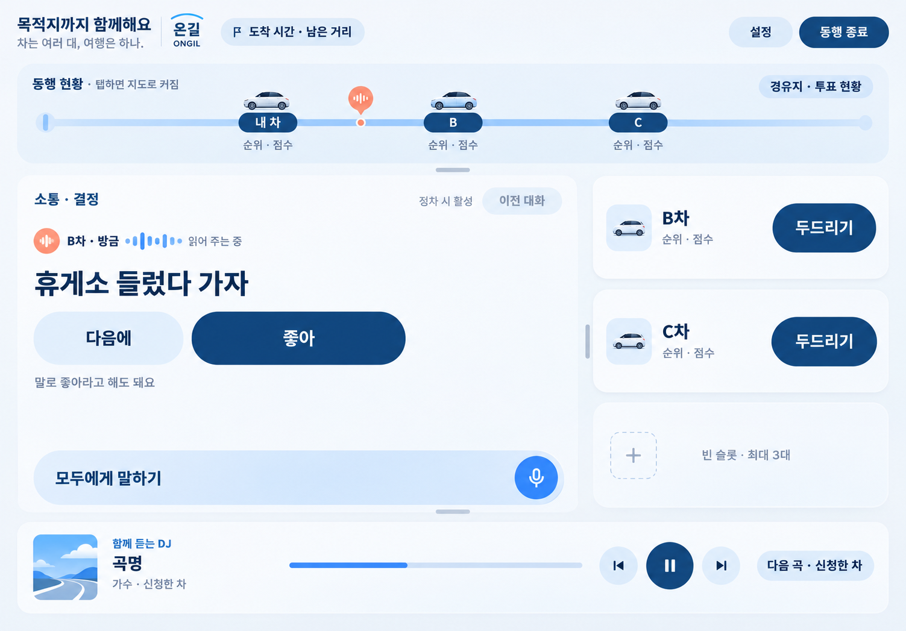

# 온길 기획·디자인 대화 기록

보관일: 2026-11-05

범위: 이 대화에서 ‘새로운 공모전’을 시작한 시점부터 사용자가 `pleos-travel-app`의 `기획서` 브랜치를 지정한 시점까지의 사용자 메시지와 공개 답변·진행 안내입니다. IDE·환경 자동 첨부, 시스템/개발 지침, 내부 추론, 도구 실행 원문은 포함하지 않습니다. 일회성 Figma OAuth 인증 URL과 링크의 추적 매개변수는 생략했습니다. 대화에서 표시했던 이미지 세 장은 해당 답변 뒤에 연결했습니다.

아래 내용은 당시 발언을 시간 순서로 보관한 기록입니다. 최종 저장 위치와 현재 승인된 방향은 [대화 정리](온길_기획_디자인_대화정리_20261105.md)를 기준으로 확인하세요.

## 1. 사용자

새로운 공모전

## 2. Codex

열려 있는 연구 메모와 작업 폴더를 확인해서, 주제에 맞는 새 공모전을 찾을 준비를 하겠습니다.

## 3. Codex

새로 참가할 **공모전을 찾으시나요**, 아니면 **정해 둔 공모전 준비를 시작하시나요?**

정해진 공모전이 있다면 공고 링크나 내용을 보내주세요. 주제와 심사 기준부터 확인하겠습니다.

## 4. 사용자

깃 어디서 가져와야하는지 알려줄테니까 기다려 피그마랑 연결하는 과정 ㅓㅁ저 할꺼야

## 5. Codex

알겠어요. 피그마 연결 먼저 진행하시고, Git 저장소 위치 알려주실 때까지 기다릴게요.

## 6. 사용자

codex mcp add figma --url https://mcp.figma.com/mcp

## 7. Codex

Figma MCP 서버를 등록하겠습니다. Codex 설정 지침을 확인한 뒤 보내주신 명령을 실행할게요.

## 8. Codex

Figma 서버 등록은 완료됐고, 계정 인증을 기다리고 있습니다. 아래 링크에서 로그인하고 연결을 승인해 주세요.

[일회성 Figma 인증 링크 생략]

## 9. Codex

Figma MCP 등록과 로그인까지 완료됐어요. `enabled / OAuth` 상태도 확인했습니다.

[OpenAI 공식 안내](https://learn.chatgpt.com/docs/extend/mcp?surface=cli)에 따라 Codex 확장을 한 번 재시작해 주세요.

## 10. 사용자

피그마에있는 와이어 프레임 가져오고싶은데 어떻게 해야돼?

## 11. Codex

피그마 연결 상태와 가져오는 방법을 확인하겠습니다.

## 12. Codex

피그마 연결은 정상이에요. **가져올 와이어프레임의 링크를 이 채팅에 보내주시면 됩니다.**

1. 피그마에서 와이어프레임 파일을 여세요.
2. 가져올 화면의 **프레임을 선택**하고 우클릭 → **Copy link to selection(선택 항목 링크 복사)**를 누르세요. [Figma 공식 안내](https://help.figma.com/hc/en-us/articles/39216419318551-Get-started-with-the-Figma-MCP-server)
3. 복사한 링크를 여기에 붙여넣어 주세요.

링크를 받으면 제가 화면 구성과 요소를 읽어와 확인할게요.

## 13. 사용자

[https://www.figma.com/design/c3q0MskWTtRP5gE9WspRVo/%ED%98%84%EB%8C%80-%EA%B3%B5%EB%AA%A8%EC%A0%84?node-id=34-99038)

## 14. Codex

보내주신 프레임의 와이어프레임과 화면 구성을 불러오겠습니다.

## 15. Codex

불러왔어요. 보내주신 프레임은 **「현대 공모전」의 S-10 ‘주행 중 메인 · 기본’ 화면(v0.3)**입니다.

- **동행 현황:** 차량 위치, 안전 운전 순위·점수, 경유지 투표
- **소통·결정:** 음성 대화, ‘좋아/다음에’ 응답, 차량 두드리기
- **함께 듣는 DJ:** 음악 재생·신청, 다음 곡 표시

옆에 있는 기능 설명과 주행·정차 시 동작 규칙까지 확인했어요. Git 저장소 알려주시면 이 화면을 기준으로 이어서 작업하겠습니다.

## 16. 사용자

지금 그 프레임에다가 무드를 입혀보고싶어 이미지로 어떤 톤이 어울릴지 만들어줘

## 17. Codex

기존 화면 구성을 유지하면서, 따뜻한 동행 느낌과 차분한 차량용 화면 톤을 입힌 이미지 시안을 만들어볼게요. 이미지 생성 스킬을 사용하겠습니다.

## 18. Codex

같은 화면에 두 가지 톤을 적용해 비교해보겠습니다. **아이보리·딥 틸**은 편안한 동행 느낌으로, **차콜·민트**는 차분한 야간 주행 느낌으로 만들겠습니다.

## 19. Codex

차량 현황, 대화, 차량 슬롯, 음악 영역의 위치는 유지하고 있습니다. 색상과 카드 표면, 글자 대비를 중심으로 무드를 바꿔서 두 시안을 비교하기 쉽게 만들고 있어요.

## 20. Codex

밝은 시안이 나왔습니다. 아이보리 바탕에 딥 틸 버튼을 넣으니 ‘함께 이동하는 서비스’의 편안한 느낌이 살아납니다. 어두운 톤도 같은 구성으로 생성 중입니다.

## 21. Codex

**첫 번째 아이보리·딥 틸 톤을 추천해요.** 따뜻하고 편안해서 ‘함께 이동하고 소통하는 서비스’의 성격과 잘 어울립니다.

**두 번째 차콜·민트 톤**은 차량 디스플레이의 차분한 느낌이 강해요. 첫 번째를 기본 디자인으로, 두 번째를 야간 모드로 가져가면 좋겠습니다.

## 22. 사용자

이미지 만들기전에 이거 현대차안에 디스플레이에 들어갈 앱이야 현대차에 어울리는 무드랑
“어서 타!” 친구가 여행에 초대하는 듯한 경쾌함
길 위에서 이어지는 우리. 한국어와 영어를 자연스럽게 결합
차는 따로 달려도 마음은 나란히. 현대차가 출발부터 마지막 인사까지 이어주는 친구들의 여행 앱.
차는 여러 대, 여행은 하나. 현대차의 주행 정보로 서로의 길을 이어, 출발부터 헤어질 때까지 함께 달리는 여행 앱.
여러 대의 차로 떠나는 여행에서는 목적지는 같아도, 이동하는 시간은 각자의 여행으로 흩어집니다. 친구들과 함께 출발했지만 차에 타는 순간 대화와 웃음, 창밖에서 발견한 풍경은 각 차량 안에만 남습니다. 한 차가 쉬고 싶어 하거나 길이 막혀 늦어져도, 다른 차에 탄 친구들은 그 상황을 바로 알기 어렵습니다.

서로 어디쯤 오는지 묻고 재미있는 순간을 나누고 싶어도, 이동 중에는 단체 채팅을 확인하거나 전화를 주고받기 어렵습니다. 특히 운전자는 안전을 위해 화면을 계속 볼 수 없습니다. 그래서 함께 떠났다는 설렘은 잠시 끊기고, 목적지에 도착해서야 다시 일행이 된 듯한 느낌이 듭니다.

우리는 이 ‘떨어져 가는 시간’도 여행의 일부라고 생각했습니다. 각 차의 이동 상황을 자연스럽게 공유하고 대화와 휴식, 합류의 순간을 이어 준다면, 서로 다른 차에 있어도 처음부터 함께 여행하는 기분을 느낄 수 있습니다. 출발부터 헤어지는 순간까지 그 연결을 이어 주기 위해 이 앱을 기획했습니다.
‘온길’은 차량이 지나가는 장소를 소통의 매개체로 활용하여, 서로 다른 시간에 이동하는 친구들이 하나의 여행을 경험하도록 연결합니다. 핵심 기능은 먼저 지나간 차량이 특정 장소에 짧은 음성 메시지를 남기면, 뒤따르는 친구 차량이 해당 위치에 도착했을 때 메시지를 전달받는 위치 기반 음성 소통입니다. 메시지를 들은 친구는 음성으로 답장을 남길 수 있으며, 그 반응이 처음 메시지를 남긴 차량에도 전달되어 양방향 대화가 이어집니다. 이후 같은 장소를 지나는 다른 차량도 대화에 참여하며, 각 차량의 경험이 하나의 이야기로 쌓입니다. 이러한 기능은 Pleos의 차량 위치 정보와 내비게이션 경로 정보를 활용해 실제 이동 장소와 소통 경험을 연결한다는 점에서 차별화됩니다. 또한 음성 중심의 인터랙션을 통해 운전 중 화면 조작을 최소화하고, 메시지는 사용자가 원하는 시점에 확인하도록 설계합니다. 기존 메신저가 사람 간 메시지 전달에 집중했다면, 온길은 실제 차량이 지나가는 장소에 친구들의 목소리와 감정을 남겨 서로 다른 시간과 공간에서 같은 순간을 공유하는 새로운 차량 중심의 여행 경험을 제공합니다.
‘온길’은 서로 다른 차량에 탄 친구들이 길 위에 남겨진 추억을 공유하고, 함께 결정하며, 이동 시간마저 하나의 여행으로 만드는 서비스입니다.
친구 6명이 차량 3대에 나누어 강릉으로 여행을 떠납니다. 먼저 달리던 A차는 한 휴게소 부근을 지나며 “야 여기 작년에 영수가 화장실 급하다고 난리 쳤던 데 아니냐ㅋㅋ”라는 음성 메시지를 남깁니다. 잠시 후 같은 장소를 지나던 B차는 이를 듣고 “ㅋㅋㅋ 근데 지금도 영수가 화장실 가고 싶대”라며 답장합니다. A차는 친구들의 반응을 전달받고 “그럼 올해도 여기서 만나야겠네ㅋㅋ”라며 장난을 이어갑니다.
이때 A차에서 “야 그럼 우리 여기서 좀 쉬었다 갈까?”라고 제안하자, 온길의 AI가 대화 속 제안을 인식해 휴게소 방문 투표를 생성합니다. 각 차량은 간단한 음성 응답으로 의견을 전달하고, 함께 휴게소에 들르기로 결정합니다. 이를 통해 운전 중 여러 차량에 일일이 전화를 걸거나 단체 채팅을 확인해야 하는 위험과 번거로움을 줄일 수 있습니다.
먼저 휴게소에 도착한 A차는 뒤따라오는 B차에 ‘두드리기’로 대화를 요청합니다. B차가 수락하자 “야 우리 음식 미리 시켜놓을게. 너희 뭐 먹을래?”라고 묻고, 친구들은 메뉴를 이야기하며 자연스럽게 대화를 이어갑니다. 이렇게 서로 떨어져 있어도 친구들을 챙기며 함께 여행하는 즐거움을 느낄 수 있습니다.
온길은 서로 다른 차에 있어도 친구들과 같은 순간에 웃고, 함께 결정하고, 서로의 여행에 자연스럽게 함께할 수 있는 경험을 제공합니다.
‘온길’은 여러 대의 차량으로 이동하는 시간을 함께 즐기는 여행 경험으로 바꾸고, 이를 통해 현대자동차만의 차별화된 차량 내 소통 가치를 제공하고자 합니다.
초기 타깃은 친구들과 여러 대의 차량으로 여행하는 20~30대입니다. 차량 위치 기반 음성 메시지로 서로의 순간을 공유하고, AI 음성 투표와 차량 간 대화 기능으로 운전 중 불필요한 연락과 화면 조작을 줄일 수 있습니다. 또한 함께 듣는 음악과 실시간 소통을 통해 이동 시간의 즐거움을 높여, 사용자들이 다음 여행에서도 온길을 찾도록 유도합니다.
초기 서비스의 성장 가능성은 월간 활성 사용자 수(MAU), 음성 메시지 참여율, 여행 그룹 생성 수, 재사용률을 중심으로 검증하고자 합니다. 첫해에는 월 1,000개 여행 그룹에 평균 6명이 참여하는 것을 가정해 MAU 6,000명, 첫 이용 후 6개월 내 재사용률 25%를 초기 목표로 설정하고, 실제 이용 데이터를 바탕으로 개선해 나갈 계획입니다. 이후 가족 여행, 자동차 동호회, 단체 이동 등으로 서비스 이용 대상을 확대하고자 합니다.
장기적으로는 여행 중 주고받은 목소리와 장소에 얽힌 추억을 축적하여, 시간이 지난 뒤에도 다시 경험할 수 있는 서비스로 발전시키고자 합니다. 나아가 자녀가 부모의 젊은 시절 여행 기록을 같은 장소에서 듣고, 당시의 경험과 감정을 공유하는 세대 간 연결까지 확장할 수 있습니다.
궁극적으로 온길은 현대자동차와 함께한 이동 경험이 소중한 추억으로 쌓이고, 그 추억이 다시 현대자동차를 선택하고 싶게 만드는 감성적 브랜드 가치를 형성하는 것을 목표로 합니다.

이게 내가 쓴 기획서 초안인데 이거에 어울리는 무드먼저 나한테 설명해주고 내가 오케이하면 이미지로 뽑아줘

## 23. Codex

기획서를 보니 온길의 중심은 ‘여러 차에 나눠 탄 친구들이 여행 내내 함께하는 느낌’이네요. 현대차·Pleos의 공식 디자인 자료를 확인해서, 차량 화면의 정돈된 인상과 친구가 초대하는 경쾌함을 어떻게 함께 담을지 설명드리겠습니다. 이미지는 오케이하신 뒤 만들게요.

## 24. Codex

온길에는 **맑고 정돈된 블루 위에, 친구가 여행에 초대하는 경쾌함을 담는 무드**가 어울려요. 떠올릴 장면은 **“주말 아침, 차 문을 열고 친구에게 ‘어서 타!’라고 말하는 순간”**입니다.

화면의 기본 구조는 안정감 있게 잡고, 문구와 작은 그래픽에서 친근함이 느껴지도록 하면 좋겠습니다. Pleos가 강조하는 단순한 구성, 일관된 아이콘과 글자, 제한된 색상 사용도 이 방향의 기준으로 삼을 수 있어요. [Pleos 공식 디자인 설명](https://pleos.ai/service-solution/pleos-connect?locale=en-US)

**색은 이렇게 제안해요.**

| 색 | 적용 | 느껴지는 인상 |
|---|---|---|
| 쿨 화이트 `#F4F7FA` | 화면 바탕 | 맑은 공기, 출발하는 아침 |
| 딥 블루 `#17365D` | 주요 글자와 중심 요소 | 차량 화면의 안정감 |
| 스카이 블루 `#649BFA` | 음성·연결 상태, 주요 포인트 | 열린 하늘, 가벼운 설렘 |
| 소프트 코랄 `#F69B82` | 친구가 남긴 메시지의 작은 표시 | 사람의 온기, 반가움 |

블루와 화이트가 화면 대부분을 이루고, 코랄은 친구의 목소리가 도착하는 순간에 조금씩 등장하는 식입니다.

**온길만의 그래픽은 ‘길과 목소리’에서 가져오면 좋겠어요.**
여러 차량을 하나의 부드러운 경로선으로 연결하고, 친구가 메시지를 남긴 장소에는 작은 음성 파형이나 말풍선을 둡니다. 차들이 서로 다른 위치에 있어도 같은 선으로 이어져 보여야 해요. 기획서의 **“차는 여러 대, 여행은 하나”**를 화면에서도 느끼게 하는 장치입니다.

카드는 가로로 시원하게 펼치고 모서리는 적당히 둥글게 하겠습니다. 경쾌함은 명료한 색과 친근한 표현, 목소리가 이어지는 작은 움직임으로 표현하면 어울립니다.

**한국어와 영어는 역할을 나눠 자연스럽게 섞는 게 좋아요.**

> **온길 ONGIL**
> 차는 여러 대, 여행은 하나.
> *Together, on the way.*

출발 화면에서는 **“어서 타! Ready to go?”**처럼 초대하는 말을 쓰고, 주행 화면의 조작 문구는 **“모두에게 말하기”**, **“같이 쉬어 갈까?”**처럼 바로 이해되는 한국어로 두는 방향입니다.

지금 S-10 프레임에 적용한다면, 상단은 **친구들이 같은 여행길에 있다는 연결감**, 중앙은 **지금 들려오는 친구의 목소리**, 하단 음악 영역은 **같은 분위기를 공유하는 즐거움**을 강조하겠습니다. 순위·점수는 보조 정보로 두면 온길의 이야기가 더 잘 드러날 것 같아요.

이 방향에 **오케이**하시면, 기존 프레임에 적용한 이미지 시안 한 장부터 만들겠습니다.

## 25. 사용자

이오케이 만들어봐

## 26. Codex

오케이. 기존 프레임 배치를 유지하고, 맑은 블루·화이트에 코랄 포인트를 더해 온길의 경쾌한 여행 무드를 이미지로 만들겠습니다.

## 27. Codex

친구들의 차를 잇는 파란 경로선과 작은 코랄색 음성 표시로 ‘길 위에서 이어지는 우리’를 표현하고 있습니다. 주행 화면에서는 한국어를 중심으로 두고, ‘온길 ONGIL’ 표기를 작게 넣는 방향입니다.

## 28. Codex

온길의 **블루·화이트 무드 시안**입니다.

기존 배치를 유지하고, 딥 블루로 안정감을, 코랄색 음성 표시로 친구의 반가움을 표현했어요. 상단 경로선은 **“차는 여러 대, 여행은 하나”**를 보여주는 요소로 잡았습니다.

## 29. 사용자

지금까지 대화나눈거 push 커밋해줘

## 30. Codex

지금까지 정한 온길 기획·디자인 방향과 생성 이미지를 기록하고, Git 저장소와 변경 사항을 확인한 뒤 커밋·푸시하겠습니다.

## 31. Codex

현재 폴더 안에서 `hongik-uni` 저장소와 GitHub 원격 저장소를 확인했습니다. 그 안에 `현대공모전_온길` 폴더를 만들어 기획서 원문, 대화 기록, 승인한 무드와 이미지 시안을 묶겠습니다.

## 32. 사용자

아니내가 이거 항상 어디다가 올리라고 말했었자나 심지어 브런치까지 따로 만들어져있는걸로 아는데?

## 33. Codex

제가 기존 지시를 확인하지 않고 저장소를 짚었습니다. 아직 파일 생성이나 커밋·푸시는 하지 않았어요. 이전 작업 기록과 브랜치 목록에서 지정해두신 위치를 찾아서 그쪽으로 진행하겠습니다.

## 34. 사용자

pleos 트레블 앱 안에 기획서 라는 브랜치 잡아서 그 안에 넣어줘
